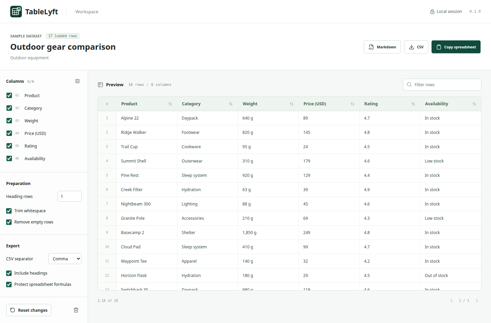

# TableLyft

A local-first browser extension for turning loaded web tables into clean, reusable data.

**Select a table -> preview -> choose columns -> copy or export.**

TableLyft is a fresh project. The earlier Wingman project remains only in Git history; no OmeTV code, models, or permissions are reused.



## Scope

- On-click table picker for ordinary HTML tables in the current page's main frame.
- Full-tab workspace with column selection, configurable headings, row filtering, and sorting.
- Spreadsheet-ready clipboard output, CSV downloads, and Markdown tables.
- Local processing, no account, no backend, no analytics, and no remote code.

Version 0.1 does not extract PDFs, images, canvas grids, cross-origin frames, or unloaded/paginated rows. Captured row counts describe the loaded table, not an entire remote dataset. Browser-internal pages and extension stores cannot be inspected.

## Development

Use Node.js 24 LTS and npm. The lockfile is the dependency source of truth.

```sh
npm ci
npm run check
npm run build
npx playwright install chromium
npm run test:e2e
npm run verify:bundle
npm run zip
```

Load `.output/chrome-mv3` using **Load unpacked** in `brave://extensions` or `chrome://extensions` with Developer mode enabled. Pin TableLyft, open an ordinary web page containing an HTML table, click the icon, then select the table. **Open sample** provides an offline dataset for trying the workspace, not proof of website compatibility.

Chromium is the initial supported target. Brave installation is supported by its Chromium extension platform, but live Brave verification is tracked separately from automated Chromium tests. Firefox is not claimed as tested.

## Architecture

WXT builds a Manifest V3 extension. React and TypeScript power the popup, picker, and workspace. Browser DOM APIs read tables; Papa Parse serializes CSV/TSV; Zod validates messages and captures. Vitest tests the data pipeline; Playwright exercises an installed extension.

See [Architecture](docs/ARCHITECTURE.md), [Workflow](docs/WORKFLOW.md), [Development](docs/DEVELOPMENT.md), [Testing](docs/TESTING.md), [Roadmap](docs/ROADMAP.md), and [Privacy](PRIVACY.md).

## Status

Version 0.1.0 includes 46 unit tests and six installed-extension browser scenarios. Local checks cover extraction, safe exports, actual CSV/clipboard contents, picker errors, pagination, cleanup, and layouts from 320 to 1440 pixels. CI repeats these checks and packages the extension. Native Brave toolbar access and Excel/Sheets imports still need manual verification; see the [release checklist](docs/TESTING.md).

## Data And Permissions

The design uses `activeTab`, `scripting`, `storage`, and `clipboardWrite`. There is no persistent website access. Captures use extension session storage, not cloud sync or durable history. Source URLs omit credentials, query strings, and fragments. Exported data leaves the extension only when the user copies or downloads it.

The project is licensed under [MIT](LICENSE).
